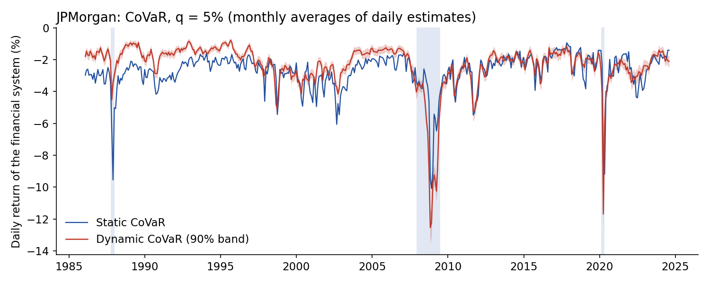
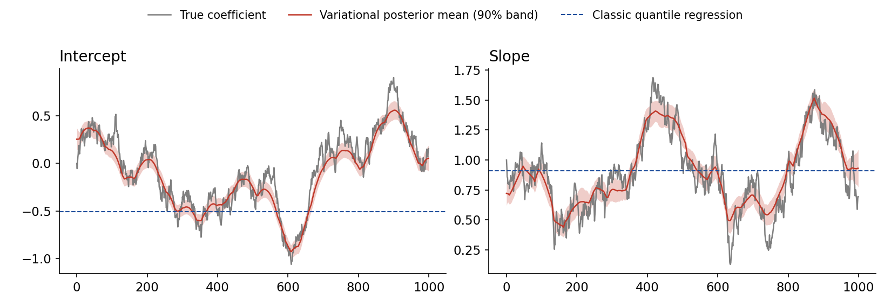
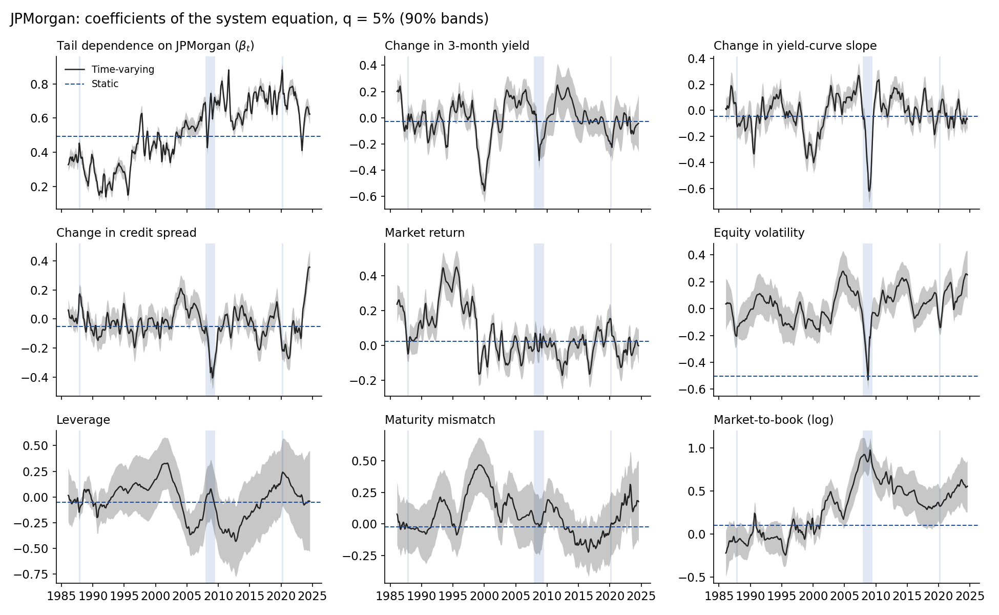

# Dynamic CoVaR

A minimal implementation of the **Dynamic CoVaR**: the CoVaR of Adrian and Brunnermeier (2016), with every coefficient allowed to drift over time. It is estimated by a fast variational Bayes algorithm.

This repository is a **proof of concept**. Its purpose is to make the method easy to try, for example by central banks and supervisors who want to monitor how the tail of the financial system depends on individual institutions. It ships with one institution's data, JPMorgan Chase, and can be run on any listed institution from public data. It is *not* the replication package of the paper, which covers hundreds of institutions from CRSP and Compustat.



## Why a Dynamic CoVaR?

In the standard CoVaR, the link between an institution and the financial system is a constant coefficient. All movement in the CoVaR comes from the state variables, so **without state variables the CoVaR is a straight line**. The Dynamic CoVaR lets the coefficients follow random walks. It can therefore track changes in tail dependence that the state variables miss.

**Simulations:**
- When the true coefficients drift, the variational posterior tracks them, with errors two to four times smaller than those of a classic quantile regression.
- When the coefficients are constant, the method selects no drift, and its estimates coincide with the classic quantile regression.



## Quick start

```bash
pip install -e .                 # installs the package and its dependencies
python examples/jpmorgan.py      # JPMorgan, daily, 1986 to 2024 (about one minute)
python examples/simulation.py    # simulation exercises (a few minutes)
python tests/test_vb.py          # checks against exact results (or: python -m pytest)
```

To estimate the model on your own data:

```python
import pandas as pd
from dynamic_covar import run

# columns: 'inst' and 'sys' (daily returns, %), plus any state variables already lagged one day
data = pd.read_csv("my_bank.csv", index_col=0, parse_dates=True)
out = run(data, q=0.05)
out["results"]        # daily static and Dynamic CoVaR and ΔCoVaR, with posterior sds
out["coef"]           # time-varying coefficients of the system equation (out["coef_sd"]: their sds)
out["kappa"]          # selected speed of coefficient drift for each regression
```

`dynamic_covar.data.load("BAC")` builds such a data set for any ticker from public sources, without balance-sheet characteristics.

For a single time-varying quantile regression, use `dynamic_covar.fit(y, X, q)`. Here `X` includes a constant, and `periods_per_year` sets the frequency, 252 by default.

## What the examples show

**JPMorgan Chase, daily, January 1986 to July 2024, 9,719 observations**, with five state variables and three balance-sheet characteristics.

- **CoVaR** ([above](figures/jpmorgan_covar_q05.png)): the Dynamic CoVaR is less severe than the static one in calm periods and markedly more severe at the trough of the global financial crisis and in March 2020.
- **ΔCoVaR** ([figure](figures/jpmorgan_delta_covar_q05.png)): JPMorgan's contribution to systemic risk, with 90% posterior bands. The bands propagate the uncertainty of both estimation stages.
- **Time-varying coefficients** ([figure](figures/jpmorgan_coefficients_q05.png)):
  - The dependence of the tail of the financial system on JPMorgan's tail rises from about 0.2 in the early 1990s to about 0.8 after 2010.
  - The effects of the state variables change sign over time. The equity-volatility coefficient, for example, reaches the static estimate only at the 2008 trough.
  - The balance-sheet coefficients also drift. The market-to-book effect rises from about zero before 2000 to nearly one in 2008, and leverage changes sign twice. A constant coefficient averages these episodes away.



## Method in brief

For a quantile level $q$, two quantile regressions are estimated, both with time-varying coefficients:

```math
\begin{aligned}
X_t^i &= \alpha_t^i + \gamma_t^{i\prime} M_{t-1} + \varepsilon_t^i, \\
X_t^S &= \alpha_t^S + \gamma_t^{S\prime} M_{t-1} + \beta_t X_t^i + \varepsilon_t^S, \\
\mathrm{VaR}_t &= \alpha_t^i + \gamma_t^{i\prime} M_{t-1}, \\
\mathrm{CoVaR}_t &= \alpha_t^S + \gamma_t^{S\prime} M_{t-1} + \beta_t \, \mathrm{VaR}_t, \\
\Delta\mathrm{CoVaR}_t &= \beta_t \left( \mathrm{VaR}_{q,t} - \mathrm{VaR}_{0.5,t} \right),
\end{aligned}
```

where the $q$-quantile of each $\varepsilon_t$ is zero. The coefficients $b_t$ of each regression follow random walks, $b_t = b_{t-1} + \eta_t$ with $\eta_t \sim N(0, Q)$.

Each regression uses the asymmetric Laplace working likelihood in its normal-exponential mixture form,

```math
y_t = x_t' b_t + \theta z_t + \phi \sqrt{\sigma z_t}\, u_t, \qquad z_t \sim \mathrm{Exp}(\sigma), \quad u_t \sim N(0,1), \qquad \theta = \frac{1-2q}{q(1-q)}, \quad \phi^2 = \frac{2}{q(1-q)}.
```

Mean-field variational Bayes uses three blocks:

- **The whole coefficient path** $b_{1:T}$ is one Gaussian block. A Kalman filter and the Durbin–Koopman smoother compute it exactly, in $O(T)$ time.
- **The mixing variables** $z_t$ follow generalised inverse Gaussian distributions with closed-form moments.
- **The asymmetric Laplace scale** $\sigma$ is inverse gamma.

The coordinate updates are accelerated by squared extrapolation, and the evidence lower bound never decreases. The drift covariance is $Q = \mathrm{diag}\big((\kappa s_j)^2\big)$, where $s_j$ is the standard error of coefficient $j$ that a classic quantile regression would have on one year of data. The drift speed $\kappa$ is chosen by maximising the evidence lower bound, so the data decide how much the coefficients move. One fit on 10,000 daily observations takes about a second.

## Data

The JPMorgan example reads [data/jpmorgan.csv](data/jpmorgan.csv):

| Column | Series | Source |
|---|---|---|
| `inst` | daily total return of JPMorgan Chase and its predecessors (Chemical Banking, Chase Manhattan), % | CRSP (PERMNO 47896) to 2021; Yahoo Finance afterwards |
| `sys` | value-weighted finance industry ("Money"), % | Kenneth French data library |
| `d_3m`, `d_slope`, `d_credit` | changes in the 3-month bill, 10-year minus 3-month slope, Baa – 10-year spread | FRED: `DTB3`, `DGS10`, `BAA10Y` |
| `mkt`, `eqvol` | market return and its 22-day realised volatility | Kenneth French data library |
| `lev` | total assets / book equity | Compustat quarterly |
| `mm` | (short-term debt − cash) / total assets | Compustat quarterly |
| `mb` | log of market equity / book equity | CRSP, Yahoo Finance, Compustat |

State variables are lagged one trading day. Balance-sheet characteristics are used from the day after each quarterly report. Over 2010–2021 the CRSP and Yahoo Finance returns have a correlation of 0.99999. The sample ends in July 2024, when the last quarterly report in the Compustat extract becomes stale.

`dynamic_covar.data.load(ticker)` downloads the same returns and state variables for any institution at run time.

Differences from the paper:
- **System portfolio:** public industry portfolios include the institution itself, which the paper excludes.
- **Relative size:** this needs the market equity of the whole financial sector and is omitted.
- **TED spread:** it is unavailable after 2022.
- **Supervisory data:** central banks can replace any of these series with their own.

## Citation

If you use this code, please cite the paper:

```
@article{DynamicCoVaR,
  title  = {Dynamic CoVaR: Drifting Tail Dependence and Fast Variational Inference},
  author = {Herculano, Miguel C. and Pinheiro, Jorge and Tsafos, Yannis D.},
  year   = {2026},
  note   = {Working paper}
}
```

## References

- Adrian, T. and Brunnermeier, M. K. (2016). CoVaR. *American Economic Review* 106(7), 1705–1741.
- Kozumi, H. and Kobayashi, G. (2011). Gibbs sampling methods for Bayesian quantile regression. *Journal of Statistical Computation and Simulation* 81(11), 1565–1578.
- Durbin, J. and Koopman, S. J. (2012). *Time Series Analysis by State Space Methods*. Oxford University Press.
- Varadhan, R. and Roland, C. (2008). Simple and globally convergent methods for accelerating the convergence of any EM algorithm. *Scandinavian Journal of Statistics* 35(2), 335–353.

## License

MIT, for the code. The software is provided as is, without warranty; it is a research proof of concept, not a production risk system. The data in `data/` remain subject to the terms of their providers (CRSP, Compustat, Yahoo Finance, FRED, Kenneth French data library).
